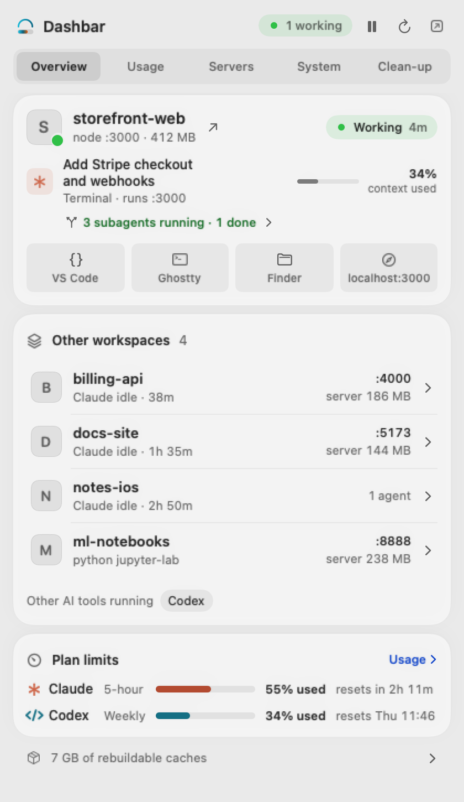
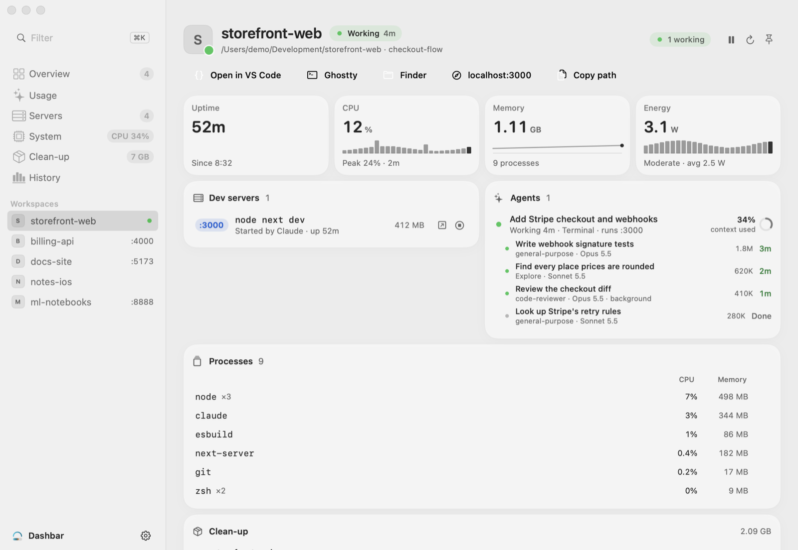
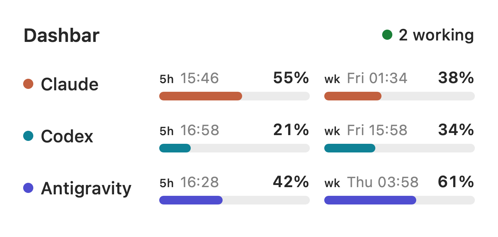

# Dashbar

A free, open-source Mac menu bar app that shows which Claude Code and Codex agents are working, how much of your plan is left and when it runs out, and which dev servers are idling.

**[Website](https://usedashbar.com/)** · [Download](https://github.com/stevenmckinnon/dashbar/releases/latest) · [Homebrew](#install) · [What's new](https://github.com/stevenmckinnon/dashbar/releases)

https://github.com/user-attachments/assets/e2f3b494-7473-4e81-be36-fe026a8cdb00

<p align="center">
  <picture>
    <source media="(prefers-color-scheme: dark)" srcset="docs/images/overview-dark.png">
    
  </picture>
  &nbsp;
  <picture>
    <source media="(prefers-color-scheme: dark)" srcset="docs/images/agents-dark.png">
    
  </picture>
</p>

<p align="center">
  <picture>
    <source media="(prefers-color-scheme: dark)" srcset="docs/images/window-dark.png">
    
  </picture>
</p>

## Install

**Download:** get the latest `Dashbar-x.y.z.dmg` from [Releases](https://github.com/stevenmckinnon/dashbar/releases/latest),
open it and drag Dashbar to Applications. It's signed with a Developer ID and notarised by Apple. Universal (Apple silicon and Intel); needs macOS 14 or later.

**Homebrew:**

```bash
brew install --cask stevenmckinnon/tap/dashbar
```

Dashbar checks for updates itself (Settings → About → Check for Updates…).

## Features

- **Agents**: live Claude Code sessions (`~/.claude/sessions`), working/idle status, and "needs you" when Claude has stopped to ask for permission or an answer (it sorts first, in amber, with a count beside the menu bar icon), plus other agent apps and CLIs it spots running (T3 Code, Codex, Cursor, Aider, Ollama…). Click a session to go back to the app it runs in (its terminal, VS Code, T3 Code or the Desktop app); right-click it to open its folder in your editor or Finder.
- **Subagents**: when a session hands work to subagents (the Agent tool, in the foreground or background), the panel says so under it ("3 subagents running", opening into a list with each one's task and how long it has run), and the Dashbar window lists them under their session with type, model, tokens and status. Finished ones drop off after a minute or so. Read from each live session's `subagents` folder beside its transcript; their tokens are counted once in the usage totals, in the project each worked in, and the usage card shows the share they used.
- **Claude Code usage**: tokens for today, the last 7 days or the last 14 (in / out / cache read / cache write), an hourly or daily chart, and in the Dashbar window the top workspaces and models, read incrementally from `~/.claude/projects/**/*.jsonl`.
- **Codex usage**: the same, plus 5h/weekly rate-limit gauges, from `~/.codex/sessions`. Shown once Codex has session logs.
- **Gemini CLI and Antigravity** (shown only if you use them): Gemini CLI sessions as agents in their workspaces (a running
  `gemini` process, working while its session log is being written) and their tokens and estimated cost per model, read
  incrementally from `~/.gemini/tmp/*/chats/*.jsonl`. The Antigravity app's conversations (working, idle or waiting for you)
  from the status columns of its `~/.gemini/antigravity/conversation_summaries.db`, opened read-only; never titles, previews
  or transcripts. For the Antigravity CLI (`agy`), Settings → Integrations → Antigravity CLI → Add to Status Line points its
  [status line](https://antigravity.google/docs/cli/statusline/) at a small script that saves only the plan quota and tier
  and each session's folder, model, token totals, estimated cost and state to `~/Library/Caches/Dashbar/antigravity-*`,
  then runs your own status line as before. Dashbar then shows Antigravity's 5-hour and weekly limits per model group with
  their pace (and in History), its usage with the CLI's own cost estimate, and its sessions, "needs you" when it asks to
  confirm a tool. Never your email or conversations. Remove puts your previous status line back exactly.
- **OpenCode** (shown only if you use it): [OpenCode](https://github.com/anomalyco/opencode) sessions (1.x and 2.x) as
  agents in their workspaces, working or idle, while an `opencode` process runs, and a Usage card with its tokens, models
  and estimated cost (OpenCode's own cost where it recorded one; no plan limits, since you bring your own provider). Read
  read-only from `~/.local/share/opencode/opencode.db`: only session ids, folders and times, and each reply's model, token
  counts and cost; never titles, prompts or replies. To see when a session is waiting for you, Settings → Integrations →
  OpenCode → Add to OpenCode puts one plugin file, `dashbar.js`, in `~/.config/opencode/plugins/`; it saves only each
  session's id, folder, state and time to `~/Library/Caches/Dashbar/opencode-sessions/`, never answers a prompt, and
  Remove deletes it.
- **GitHub Copilot (CLI and VS Code agent)** (shown only if you use it): [Copilot CLI](https://github.com/github/copilot-cli)
  sessions, and Copilot's agent sessions in VS Code (which keep the same session folders), as agents in their workspaces,
  working, idle or asking permission, while the process holding each session runs, and a Usage card with
  its tokens, models and premium requests, updated as Copilot works and confirmed by each session's own totals when it
  ends; it shows no cost (Copilot is billed by your plan) and no plan limits (those are only on GitHub, which Dashbar never
  asks). Read from `~/.copilot/session-state/` (`$COPILOT_HOME` if set): the folder and host from each session's
  `workspace.yaml`, each event's type near the end of `events.jsonl`, and only the model and token fields of its
  `session.usage_record` and `session.shutdown` records; never prompts, replies, tool input or results, or session titles. Copilot writes no event log until a
  prompt is sent, so a session with nothing typed adds nothing. To see a session that needs you the moment it asks (in the terminal or VS Code), Settings →
  Integrations → GitHub Copilot → Add to Copilot puts one file, `dashbar.json`, in `~/.copilot/hooks/`, using Copilot's own hooks; its script saves
  only each session's id, folder, state and time to `~/Library/Caches/Dashbar/copilot-sessions/`, never answers a
  permission, and Remove deletes it.
- **Show in Dashbar, per tool**: each tool other than Claude Code has a Show in Dashbar switch at the top of its section in
  Settings → Integrations (Gemini CLI and Antigravity share one). Off hides it everywhere (workspaces, Usage, History,
  limits, notifications, the island, the menu bar, widgets and the `dashbar` command) and stops Dashbar reading its files
  at all; anything you added to it stays installed, and switching it back on brings everything back.
- **More than one account**: if you run Claude Code with [`CLAUDE_CONFIG_DIR`](https://code.claude.com/docs/en/authentication#log-in-with-multiple-accounts) (say `~/.claude-work` beside `~/.claude`) or Codex with `CODEX_HOME`, add each folder in Settings → Accounts (Dashbar suggests `~/.claude-*` and `~/.codex-*` folders with logs, looking only at the top of your home folder). It reads every account's sessions and usage, names them by account (only once there's more than one), and shows each Claude account's plan limits from its own status line, saved to `~/Library/Caches/Dashbar/claude-statusline-<id>.json`.
- **Estimated cost**: what the period's tokens would cost at public API list prices, per model and project, worked out on your Mac from the token counts (a guide for subscribers, not a bill; models without a known price are named, never counted as $0). Settings → General can hide it.
- **History**: a page in the Dashbar window (or click a card's header on the Usage tab) with each 5-hour and weekly plan window's peak over the last 30 days (how often you hit the limit; with more than one account, one card per account), the current window against an even pace, and 30 days of tokens and estimated cost per day by agent, project and model. Plan readings are kept for 90 days in `~/Library/Application Support/Dashbar/plan-history.json` (usually tens of KB; each extra account beside it as `plan-history-<id>.json`); usage comes from the scan Dashbar already does.
- **Local servers**: listening TCP ports with their project name, command and uptime. Hover a row to open it in the browser or stop the process.
  Servers up over an hour that use almost no CPU are marked "barely used", and servers started from a Claude Code
  session say so (the session shows what it runs).
- **System tab**: CPU (user/system split, load average), memory (app/wired/compressed, swap, and macOS memory
  pressure), network up/down, GPU utilisation, disk, battery with time remaining, and the busiest apps right
  now with their icons. Recent samples show as small bar charts.
- **Dashbar window**: the arrow button in the panel header, or ⌃⌥D from anywhere, opens Dashbar as a full window: the panel's pages and every running workspace in a sidebar. A workspace's page shows its uptime, CPU, memory and energy (its servers, agents, what they started and anything else working in its folder), its dev servers and agents, and the processes behind the numbers. There's a pin to keep it on top; ⌃⌥D again closes it.
- **Jump to the agent that needs you** (Settings → General; no shortcut until you record one): a shortcut you pick that, from anywhere, brings forward the app of the session that has waited longest for you (a permission prompt or a question, from any tool Dashbar shows), or, with none waiting, the one that finished last, as clicking its row does. With neither it does nothing. Tools switched off in Show in Dashbar never count. The release and a local build each keep their own, and Settings says when the shortcut can't work (macOS or ⌃⌥D already uses it, or the other copy has the same one).
- **Island** (Settings → Notifications; on for new installs, except on a Mac with a touch display, where it starts off to stay out of the way of the Dynamic Island): when an agent finishes or stops for you, a black banner grows out of the MacBook notch (or just below the middle of the menu bar on other screens) with the session's title and project, then folds back into the notch after a few seconds (hover holds it open). Click it to go back to the session; with answering permission prompts on, Allow once and Deny work right there. Between moments it draws nothing, so the notch and the menus around it are untouched. Optionally it keeps a small status beside the notch (amber "needs you", else green "working") that lists your sessions on hover; that can cover the last menus of a menu-heavy app. If another app already draws at the notch, it sits just below that app's (or choose left or right of the notch), and it can stand in for the matching notifications.
- **First run**: a short welcome window says what Dashbar reads and lets you turn on notifications, open at login and Claude plan limits. macOS asks about notifications only when you turn one on. It's in the gear menu as Welcome… later.
- **Notifications** (each can be turned off in Settings): when an agent finishes a stretch of work, when it needs you, and when a plan limit runs low: at 80%, when it's on course to run out before it resets, when it's used up, and when a used-up limit resets, once per window.
- **Tabs**: Overview · Usage · Servers · System · Clean-up (⌘1–⌘5). Overview puts what needs you first: waiting permission prompts, then the workspace whose agent is waiting, working or went idle in the last 10 minutes, the other workspaces, servers outside them, a strip with each account's tightest plan limit (click it for Usage) and, from 1 GB, a line to Clean-up. Usage has one card per tool, the one closest to running out of plan first: its plan limits with their pace, the period's tokens with the estimated cost, a chart and the in / out / cache split. One Today · 7d · 14d choice at the top drives every card and is kept between launches; with two or more tools in use, a line above the cards adds them up. A tool with no usage in the period and no limits folds to one line.
- **Menu bar stats** (optional, in Settings): CPU, memory, download speed and, with Claude plan limits on, what's left
  of your Claude 5-hour or weekly limit, beside the icon.
- **Desktop widgets**: add Dashbar from the widget gallery (right-click the desktop, Edit Widgets). Small widgets show
  Claude's, Codex's or Antigravity's plan limits and when they reset, or OpenCode's or GitHub Copilot's tokens today; the
  medium ones each tool's limits (Claude, Codex, Antigravity) and how many agents are working, or each tool's tokens today
  with the estimated cost. A tool switched off in Show in Dashbar is left out, and its own widget says so. They follow
  light, dark and tinted widgets. The widgets read a small copy of the status that Dashbar saves in its own App Group
  container (`~/Library/Group Containers/<team>.fun.dashbar.app`, readable only by you): plan percentages, reset times,
  plan names, agent counts and each tool's totals for today, no project names, folders or sessions. macOS decides how often widgets refresh, so they can lag a few minutes; when Dashbar isn't running they dim
  and say since when.

  <picture>
    <source media="(prefers-color-scheme: dark)" srcset="docs/images/widget-medium-dark.png">
    
  </picture>
- **Plan limits**: Codex's 5-hour and weekly limits from its own logs. Claude's come from Claude Code's
  [status line](https://code.claude.com/docs/en/statusline), which Claude Code passes your usage after each
  reply (Pro, Max and Ultra plans). Off until you choose Settings → Integrations → Add to Status Line: Dashbar then
  sets `statusLine` in `~/.claude/settings.json` (or `$CLAUDE_CONFIG_DIR`) to a small script,
  `~/Library/Application Support/Dashbar/claude-statusline-bridge.sh`, that saves only the `rate_limits` part
  and the time to `~/Library/Caches/Dashbar/claude-statusline.json`, then runs the status line you had before,
  if any, with the same input, so it looks the same. It keeps a backup of the settings file (in
  `~/Library/Application Support/Dashbar/Backups`), and Remove puts your previous status line back exactly. No
  network, no Keychain. The reading is as fresh as your last Claude Code reply, and Dashbar says how old it is.
  Each limit shows a tick for an even pace and a projection of when it would run out at the current rate.
- **The older, experimental way** (off by default, under Experimental in Integrations): read Claude Code's sign-in from the Keychain the
  way Claude Code does (with macOS's `security` tool, so macOS doesn't ask again each time Claude Code renews
  it) and call the same undocumented endpoint as Claude Code's `/usage`. It never refreshes or stores the
  sign-in. If Claude rate-limits the request, Dashbar keeps the last reading and waits before asking again;
  copies of Dashbar on the same Mac share their last reading (`~/Library/Caches/Dashbar/claude-plan.json`,
  percentages and reset times only) so only one of them asks. With both on, Dashbar shows the newer reading
  and doesn't ask while the status line's is current.
- **Answer permission prompts** (off by default, in Integrations): when Claude Code is about to ask you to allow a tool,
  Dashbar shows what it wants to do (the command, file or address) under that session, in the window and on the
  "needs permission" notification, with Allow once and Deny. Open session hands the prompt back to the terminal
  and takes you there. Choosing Add to Claude Code puts one
  [`PermissionRequest` hook](https://code.claude.com/docs/en/hooks#permissionrequest) in `~/.claude/settings.json`
  (after a backup, keeping any hooks you have) pointing at
  `~/Library/Application Support/Dashbar/claude-permission-bridge.sh`. The script leaves the request in
  `~/Library/Application Support/Dashbar/Permissions` (readable only by you, file contents and edits left out)
  and waits up to 5 minutes (adjustable) for your answer. Claude Code keeps its own prompt up in the terminal the
  whole time, so you can answer in either place, and a prompt answered in the terminal leaves Dashbar. It never
  answers by itself: if you don't answer, Dashbar isn't running, or anything goes wrong, it prints nothing and the
  terminal prompt is the one that counts. Allow
  once adds nothing to your permission rules, and Deny tells Claude you said no. Dashbar can only answer prompts
  Claude Code would show you anyway. Remove takes out only Dashbar's hook. With more than one account, Integrations lists
  each one: Add puts the hook in that account's own `settings.json`, and a prompt says which account it came from.

- **Live menu bar status**: the icon's bar sweeps while agents work (a one-second sweep every five seconds; still with
  Reduce Motion or the setting off) beside the working count, an amber hand and count when an agent needs you, and a
  green "Done · project" for five seconds when one finishes. Settings → Menu Bar picks the text beside the icon
  (nothing, the count, or the count and how long the longest-running agent has been at it).

## Command-line tool

Dashbar comes with `dashbar`, a small command that prints what Dashbar knows, for tmux status bars, shell prompts and
scripts. It reads a status file the running app keeps up to date and never reads agent logs itself, so it costs nothing
and Dashbar has to be running.

```console
$ dashbar
Needs you
  billing-api  Claude · needs permission · 32s
Working
  storefront-web  Claude · 4m · 3 subagents
Idle
  docs-site  Claude · 1h 35m
Plan limits
  Claude 5-hour  55% · resets in 2h 11m
  Claude Weekly  38% · resets Thu 06:02
  Codex Weekly   34% · resets Thu 20:26
Today
  Claude 152.7M tokens · Codex 9.5M tokens
Servers
  storefront-web  :3000 node

$ dashbar line
⚠ 1 needs you · 1 working · Claude 5h 55%
```

- `dashbar` or `dashbar status`: agents that need you, agents working and idle, every plan limit (the one closest to
  running out first, with its pace), today's tokens and dev servers. It follows the panel: an account is named only
  when more than one is in use, a long list of limits leaves out its rows at 0% (and says how many), tools with no
  tokens today are left out, and servers are listed one per process, as on the Servers tab.
- `dashbar line`: one line for a status bar or prompt. Add `--ascii` where `⚠` and `·` don't draw (it prints
  `! 1 needs you | 1 working | Claude 5h 55%`). An arrow (`↑`, or `(!)`) after a limit means it's on course to run out.
- `dashbar status --json`: the same status as JSON, with each limit's pace worked out when you ask.
- `--local` reads a local build (Dashbar Local) instead of the release; without it, the release is read if it's
  running, otherwise the local build.

If Dashbar isn't running, `dashbar` prints nothing on standard output, says why on standard error and exits non-zero,
so a status bar shows nothing rather than old figures. Exit status: `0` printed the current status, `2` Dashbar hasn't
saved a status yet (open Dashbar 0.7.1 or later), `3` Dashbar isn't running, `4` the status file can't be read, `64`
an unknown command or option.

**Install:** Homebrew links it for you. With the DMG, link it yourself (or copy the same command from Settings →
Integrations → Command-line tool):

```bash
sudo mkdir -p /usr/local/bin && sudo ln -sf /Applications/Dashbar.app/Contents/Helpers/dashbar /usr/local/bin/dashbar
```

**tmux** (`~/.tmux.conf`; tmux reruns it every `status-interval` seconds):

```tmux
set -g status-right '#(dashbar line --ascii)'
set -g status-interval 10
```

**zsh prompt** (`~/.zshrc`):

```zsh
setopt prompt_subst
RPROMPT='$(dashbar line 2>/dev/null)'
```

**Starship** (`~/.config/starship.toml`):

```toml
[custom.dashbar]
command = "dashbar line"
when = "command -v dashbar"
format = "[$output]($style) "
```

**Claude Code:** `dashbar line` works as Claude Code's [status line](https://code.claude.com/docs/en/statusline)
command too (`"statusLine": {"type": "command", "command": "dashbar line"}`). If Dashbar's plan limits bridge is already
in your status line, press Remove in Settings → Integrations, set the status line to `dashbar line`, then press Add to
Status Line again: the bridge runs your status line after saving the limits, so both work. An agent can also run
`dashbar status --json` to see which dev servers and agents are already running.

The status file is `~/Library/Caches/Dashbar/CLI/status.json` (a local build's is under `Dashbar Local`), readable only
by you. It holds each session's tool, state, workspace folder and how long it's been in that state, plan percentages
and reset times, today's token counts and dev server ports: never prompts, session titles, session ids, permission
request details or sign-ins. Dashbar rewrites it only when something in it changes, at most every 3 seconds. Servers are
as of the last time Dashbar read ports, which it does while its panel or window is open; `dashbar` leaves out any that
have stopped since.

## How it differs

- **Local only.** It reads the session logs Claude Code, Codex and Gemini CLI already write on your Mac (`~/.claude`, `~/.codex`, `~/.gemini` and any account folders you add), lists listening ports with libproc and measures folders. No browser cookies, no Full Disk Access, no account, no analytics.
- **Nothing is sent**, except Sparkle's update checks to GitHub and, if you turn it on, the experimental Claude plan-limits request to `api.anthropic.com` (the same read-only call Claude Code's `/usage` makes). The recommended way to see Claude plan limits sends nothing: only when you press Add does Dashbar change the `statusLine` setting in Claude Code's `settings.json` (after a backup), so a local script saves your usage percentages to a file on your Mac.
- **Reads, and acts only when you click.** Dashbar changes Claude Code's `settings.json` (or the Antigravity CLI's) only when you press Add (the status line, or the permission hook), after a backup, and Remove puts it back. If you turn on answering permission prompts, it answers one only when you click Allow once or Deny, never by itself and never by changing your permission rules; anything else falls back to Claude Code's own prompt.
- **One app for the whole picture.** Agents (working, idle, waiting for you), plan limits with a pace mark and a projected run-out time, dev servers grouped by project, what each workspace's processes use, system stats and a clean-up of rebuildable caches, in the panel or in a window.

## Settings

Open from the gear menu or ⌘, : which panel sections show, refresh interval, which editor and
terminal the quick actions open, notifications, the island, launch at login, and the folders clean-up scans
(defaults to whichever of `~/Development`, `~/Developer`, `~/Projects`, `~/Code`, `~/src` exist).

If Claude Code or Codex change their log format, Dashbar shows a warning rather than silently
reporting zero.

## Building from source

Needs macOS 14+ and Xcode / Swift 6.

```bash
swift test              # tests
./build.sh --run        # build "Dashbar Local.app" and launch it
```

See [CONTRIBUTING.md](CONTRIBUTING.md) for local builds, releasing and the rules for changes. Bugs and ideas go in [issues](https://github.com/stevenmckinnon/dashbar/issues); security reports are described in [SECURITY.md](SECURITY.md). For anything else, email [hello@usedashbar.com](mailto:hello@usedashbar.com).

## Privacy

Everything stays on your Mac. Dashbar reads local agent logs, lists listening ports and measures cache
folders. Claude plan limits come from Claude Code's status line: with your consent Dashbar changes that one
setting so a local script saves your usage percentages to a file, and it sends nothing. The Antigravity CLI's
bridge works the same way and picks its fields one by one, so your email, conversation titles and transcript
paths in that status line's input are never saved. The Antigravity app's database is only ever opened read-only. So is
OpenCode's; its optional plugin saves only each session's state and folder. Copilot's session logs are read, never written,
and its optional hook saves only each session's state and folder. The only network
requests are update checks and the optional experimental plan-limits setting, which sends Claude Code's own
sign-in to Anthropic's usage endpoint, the same call Claude Code makes.

Answering permission prompts is the one feature that acts on an agent, and only when you click Allow or Deny.
Requests and answers pass through files only your user can read, named with 128 random bits. Another program
running as you could write an answer file, but such a program could equally type into your terminal or edit
Claude Code's settings, so this opens nothing new to it. Nothing about the request leaves your Mac.

## Licence

MIT. See `LICENSE`. Not affiliated with Anthropic, OpenAI or Google.

<a href="https://kittylaunch.com/p/dashbar?utm_source=badge" target="_blank" rel="noopener">
  
</a>
