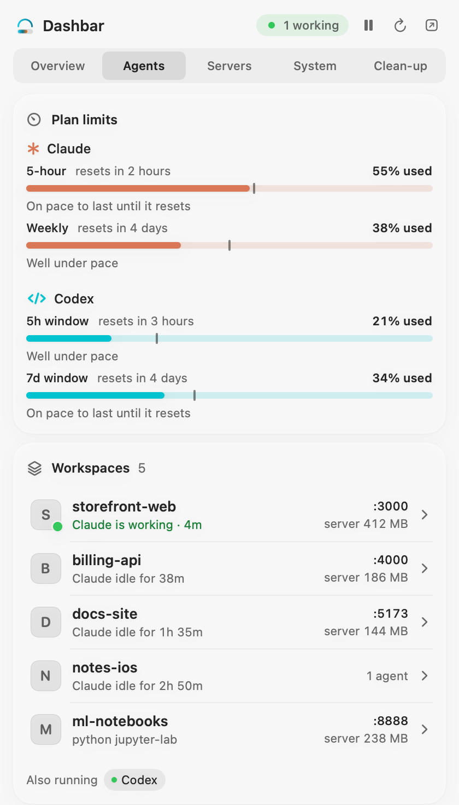

# Dashbar

A free, open-source Mac menu bar app that shows which Claude Code and Codex agents are working, how much of your plan is left and when it runs out, and which dev servers are idling.

**[Website](https://stevenmckinnon.github.io/dashbar/)** · [Download](https://github.com/stevenmckinnon/dashbar/releases/latest) · [Homebrew](#install) · [What's new](https://github.com/stevenmckinnon/dashbar/releases)

<p align="center">
  <picture>
    <source media="(prefers-color-scheme: dark)" srcset="docs/images/overview-dark.png">
    
  </picture>
  &nbsp;
  <picture>
    <source media="(prefers-color-scheme: dark)" srcset="docs/images/agents-dark.png">
    
  </picture>
</p>

<p align="center">
  <picture>
    <source media="(prefers-color-scheme: dark)" srcset="docs/images/window-dark.png">
    
  </picture>
</p>

## Install

**Download:** get the latest `Dashbar-x.y.z.dmg` from [Releases](https://github.com/stevenmckinnon/dashbar/releases/latest),
open it and drag Dashbar to Applications. It's signed with a Developer ID and notarised by Apple. Universal (Apple silicon and Intel); needs macOS 14 or later.

**Homebrew:**

```bash
brew install --cask stevenmckinnon/tap/dashbar
```

Dashbar checks for updates itself (Settings → About → Check for Updates…).

## Features

- **Agents**: live Claude Code sessions (`~/.claude/sessions`), working/idle status, and "needs you" when Claude has stopped to ask for permission or an answer (it sorts first, in amber, with a count beside the menu bar icon), plus other agent apps and CLIs it spots running (T3 Code, Codex, Cursor, Gemini, Aider, Ollama…). Click a session to go back to the app it runs in (its terminal, VS Code, T3 Code or the Desktop app); right-click it to open its folder in your editor or Finder.
- **Claude Code usage**: today's tokens (in / out / cache read / cache write), a 14-day chart, and top projects and models, read incrementally from `~/.claude/projects/**/*.jsonl`.
- **Codex usage**: the same, plus 5h/weekly rate-limit gauges, from `~/.codex/sessions`. Shown once Codex has session logs.
- **Estimated cost**: what the period's tokens would cost at public API list prices, per model and project, worked out on your Mac from the token counts (a guide for subscribers, not a bill; models without a known price are named, never counted as $0). Settings → General can hide it.
- **Local servers**: listening TCP ports with their project name, command and uptime. Hover a row to open it in the browser or stop the process.
  Servers up over an hour that use almost no CPU are marked "barely used", and servers started from a Claude Code
  session say so (the session shows what it runs).
- **System tab**: CPU (user/system split, load average), memory (app/wired/compressed, swap, and macOS memory
  pressure), network up/down, GPU utilisation, disk, battery with time remaining, and the busiest apps right
  now with their icons. Recent samples show as small bar charts.
- **Dashbar window**: the arrow button in the panel header, or ⌃⌥D from anywhere, opens Dashbar as a full window: the panel's pages and every running workspace in a sidebar. A workspace's page shows its uptime, CPU, memory and energy (its servers, agents, what they started and anything else working in its folder), its dev servers and agents, and the processes behind the numbers. There's a pin to keep it on top; ⌃⌥D again closes it.
- **First run**: a short welcome window says what Dashbar reads and lets you turn on notifications, open at login and Claude plan limits. macOS asks about notifications only when you turn one on. It's in the gear menu as Welcome… later.
- **Notifications** (each can be turned off in Settings): when an agent finishes a stretch of work, when it needs you, and when a plan limit runs low: at 80%, when it's on course to run out before it resets, and when it's used up, once per window.
- **Tabs**: Overview · Agents · Servers · System · Clean-up (⌘1–⌘5). Overview tiles jump to their tab.
- **Menu bar stats** (optional, in Settings): CPU, memory, download speed and, with Claude plan limits on, what's left
  of your Claude 5-hour or weekly limit, beside the icon.
- **Plan limits**: Codex's 5-hour and weekly limits from its own logs. Claude's come from Claude Code's
  [status line](https://code.claude.com/docs/en/statusline), which Claude Code passes your usage after each
  reply (Pro, Max and Ultra plans). Off until you choose Settings → Labs → Add to Status Line: Dashbar then
  sets `statusLine` in `~/.claude/settings.json` (or `$CLAUDE_CONFIG_DIR`) to a small script,
  `~/Library/Application Support/Dashbar/claude-statusline-bridge.sh`, that saves only the `rate_limits` part
  and the time to `~/Library/Caches/Dashbar/claude-statusline.json`, then runs the status line you had before,
  if any, with the same input, so it looks the same. It keeps a backup of the settings file (in
  `~/Library/Application Support/Dashbar/Backups`), and Remove puts your previous status line back exactly. No
  network, no Keychain. The reading is as fresh as your last Claude Code reply, and Dashbar says how old it is.
  Each limit shows a tick for an even pace and a projection of when it would run out at the current rate.
- **The older, experimental way** (off by default, also in Labs): read Claude Code's sign-in from the Keychain the
  way Claude Code does (with macOS's `security` tool, so macOS doesn't ask again each time Claude Code renews
  it) and call the same undocumented endpoint as Claude Code's `/usage`. It never refreshes or stores the
  sign-in. If Claude rate-limits the request, Dashbar keeps the last reading and waits before asking again;
  copies of Dashbar on the same Mac share their last reading (`~/Library/Caches/Dashbar/claude-plan.json`,
  percentages and reset times only) so only one of them asks. With both on, Dashbar shows the newer reading
  and doesn't ask while the status line's is current.

The menu bar shows the number of working Claude sessions beside the icon, and the icon's bar fills while any are working.

## How it differs

- **Local only.** It reads the session logs Claude Code and Codex already write on your Mac, lists listening ports with libproc and measures folders. No browser cookies, no Full Disk Access, no account, no analytics.
- **Nothing is sent**, except Sparkle's update checks to GitHub and, if you turn it on, the experimental Claude plan-limits request to `api.anthropic.com` (the same read-only call Claude Code's `/usage` makes). The recommended way to see Claude plan limits sends nothing: only when you press Add does Dashbar change the `statusLine` setting in Claude Code's `settings.json` (after a backup), so a local script saves your usage percentages to a file on your Mac.
- **One app for the whole picture.** Agents (working, idle, waiting for you), plan limits with a pace mark and a projected run-out time, dev servers grouped by project, what each workspace's processes use, system stats and a clean-up of rebuildable caches, in the panel or in a window.

## Settings

Open from the gear menu or ⌘, : which panel sections show, refresh interval, which editor and
terminal the quick actions open, notifications, launch at login, and the folders clean-up scans
(defaults to whichever of `~/Development`, `~/Developer`, `~/Projects`, `~/Code`, `~/src` exist).

If Claude Code or Codex change their log format, Dashbar shows a warning rather than silently
reporting zero.

## Building from source

Needs macOS 14+ and Xcode / Swift 6.

```bash
swift test              # tests
./build.sh --run        # build "Dashbar Local.app" and launch it
```

See [CONTRIBUTING.md](CONTRIBUTING.md) for local builds, releasing and the rules for changes. Bugs and ideas go in [issues](https://github.com/stevenmckinnon/dashbar/issues); security reports are described in [SECURITY.md](SECURITY.md).

## Privacy

Everything stays on your Mac. Dashbar reads local agent logs, lists listening ports and measures cache
folders. Claude plan limits come from Claude Code's status line: with your consent Dashbar changes that one
setting so a local script saves your usage percentages to a file, and it sends nothing. The only network
requests are update checks and the optional experimental plan-limits setting, which sends Claude Code's own
sign-in to Anthropic's usage endpoint, the same call Claude Code makes.

## Licence

MIT. See `LICENSE`. Not affiliated with Anthropic or OpenAI.
